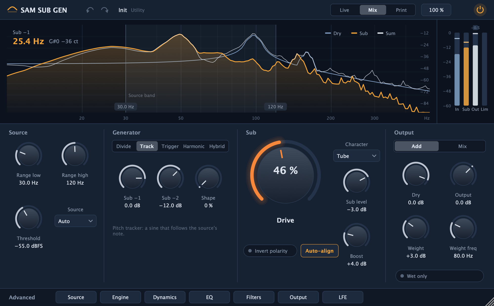

# SAM SUB GEN

A subharmonic generator and sub-bass enhancer plug-in (VST3, AU; AAX built in CI only) for macOS (universal) and
Windows x64. It derives a sub an octave or two below the source with one of five engines (Divide, Track, Trigger,
Harmonic, Hybrid), shapes it with a dedicated sub chain and routes it to stereo, surround or the LFE channel.

**Status:** in development; development previews with installers are on the
[releases page](https://github.com/ffsfdfhbdg01/SUB-GEN/releases). The specification is in
[docs/SPEC.md](docs/SPEC.md) (in Polish). The repository, files and bundles keep the working name SUB-GEN.



## Building

Requirements: CMake 3.25 or newer, Ninja, and on macOS the Xcode Command Line Tools (full Xcode is not needed); on
Windows, Visual Studio 2022 (MSVC).

```
git clone --recurse-submodules https://github.com/ffsfdfhbdg01/SUB-GEN.git
cd SUB-GEN
cmake --preset dev && cmake --build --preset dev
ctest --preset dev
```

The `release` preset builds universal macOS binaries; `asan` and `tsan` build with sanitizers. A build copies the
plug-in to the user plug-in folders (`~/Library/Audio/Plug-Ins/VST3` and `Components` on macOS).

## Licence

SUB-GEN is licensed under the GNU Affero General Public License v3.0 or later; see [LICENSE](LICENSE). It uses
JUCE under the AGPLv3; third-party components and their licences are listed in
[THIRD_PARTY_LICENSES.md](THIRD_PARTY_LICENSES.md).
